# divoom-ditoo-pro-controller

A CLI tool to control a Divoom Ditoo Pro over Bluetooth (SPP/RFCOMM).
The original app from the vendor is proprietary; this project reverse-engineers the protocol.

# Claude Code status display (the fun part)

This tiny pixel speaker now sits on a desk and tells you what Claude Code is up
to, without you ever looking at the terminal. Think of it as a mood ring for
your agent. No speaker, no mic, so it's office-safe.

- 🤔 **What's Claude doing?** Thinking, working, compacting, done, broken. One glance.
- 🙋 **Does it need me? Why?** A padlock means approve something, a `?` means
  answer a question, a page means review a plan. Ignore it and it gets louder.
- 🤖 **Agents everywhere?** One dot per subagent along the top row, lighting
  up as each one finishes.
- 🌙 **Walked away?** A build that fails at 3am is still red at 9.
- 📅 **Meetings?** Counts down to your next one, then tells anyone walking up
  that you're in it.
- ⌨️ **The keyboard joins in.** The Ditoo's key lights pulse on alerts and
  sparkle on success.

Setup and the full tour are in [integrations/claude-code](integrations/claude-code/README.md).

## Pick a mascot

Every theme is drawn pixel by pixel on the 16x16 grid. Switch with `--theme`
and reinstall:

```bash
python3 integrations/claude-code/faces/generate_faces.py --theme clawd     # or santa, clauddy
python3 integrations/claude-code/faces/generate_glyphs.py --theme clawd    # or glyphs
python3 integrations/claude-code/faces/make_screensaver.py --theme clawd   # or santa, embers
./integrations/claude-code/install-launchagent.sh
```

### Clawd (default)

A chunky terracotta desk companion with a prop for every mood.

<table>
<tr><td align="center">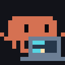<br><sub>thinking</sub></td><td align="center"><br><sub>working</sub></td><td align="center"><br><sub>compacting</sub></td><td align="center">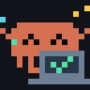<br><sub>success 🎉</sub></td><td align="center">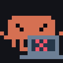<br><sub>error 💥</sub></td></tr>
<tr><td align="center"><br><sub>needs you</sub></td><td align="center">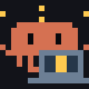<br><sub>still waiting…</sub></td><td align="center">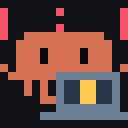<br><sub>HELLO??</sub></td><td align="center">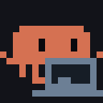<br><sub>chilling</sub></td></tr>
</table>

When it needs you, and when it's talking to the room:

<table>
<tr><td align="center">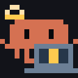<br><sub>approve something</sub></td><td align="center">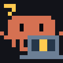<br><sub>answer a question</sub></td><td align="center">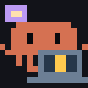<br><sub>review a plan</sub></td><td align="center">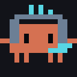<br><sub>in a meeting</sub></td><td align="center"><br><sub>heads-down</sub></td></tr>
</table>

<details>
<summary><b>…and 17 more things Clawd does while working</b></summary>

<table>
<tr><td align="center"><br><sub>starting</sub></td><td align="center"><br><sub>reading</sub></td><td align="center">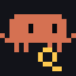<br><sub>searching</sub></td><td align="center"><br><sub>writing</sub></td><td align="center"><br><sub>terminal</sub></td><td align="center">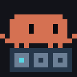<br><sub>testing</sub></td></tr>
<tr><td align="center"><br><sub>building</sub></td><td align="center">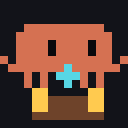<br><sub>installing</sub></td><td align="center"><br><sub>reviewing</sub></td><td align="center"><br><sub>planning</sub></td><td align="center"><br><sub>connecting</sub></td><td align="center"><br><sub>responding</sub></td></tr>
<tr><td align="center"><br><sub>configuring</sub></td><td align="center">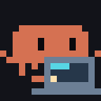<br><sub>delegating</sub></td><td align="center"><br><sub>taskdone</sub></td><td align="center">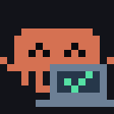<br><sub>done</sub></td><td align="center"><br><sub>cancelled</sub></td></tr>
</table>

</details>

<table><tr><td align="center"><br><sub>screensaver: the runaway cursor</sub></td></tr></table>

### Santa

Ho ho ho, it's always December on this desk.

<table>
<tr><td align="center"><br><sub>thinking</sub></td><td align="center"><br><sub>working</sub></td><td align="center"><br><sub>compacting</sub></td><td align="center"><br><sub>success 🎉</sub></td><td align="center">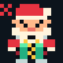<br><sub>error 💥</sub></td></tr>
<tr><td align="center"><br><sub>needs you</sub></td><td align="center"><br><sub>still waiting…</sub></td><td align="center"><br><sub>HELLO??</sub></td><td align="center"><br><sub>chilling</sub></td></tr>
</table>

Santa has a 25-second comedy screensaver too: `make_screensaver.py --theme santa`.

### Clauddy

The original. A little builder in a construction workshop: blueprints, hammers,
and a building that cracks when things go wrong.

<table>
<tr><td align="center"><br><sub>thinking</sub></td><td align="center">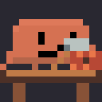<br><sub>working</sub></td><td align="center"><br><sub>compacting</sub></td><td align="center">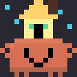<br><sub>success 🎉</sub></td><td align="center"><br><sub>error 💥</sub></td></tr>
<tr><td align="center"><br><sub>needs you</sub></td><td align="center"><br><sub>still waiting…</sub></td><td align="center"><br><sub>HELLO??</sub></td><td align="center"><br><sub>chilling</sub></td></tr>
</table>

### Glyphs

No character, just bold symbols on coloured grounds. Readable from across the
room, for the alerts and presence states.

<table>
<tr><td align="center"><br><sub>approve something</sub></td><td align="center"><br><sub>answer a question</sub></td><td align="center"><br><sub>review a plan</sub></td><td align="center"><br><sub>in a meeting</sub></td><td align="center"><br><sub>heads-down</sub></td></tr>
</table>

### Embers

The calm screensaver: slow drifting embers that never look like a status.

<table><tr><td align="center"><br><sub>screensaver</sub></td></tr></table>

# Features

- **Display**: send images (PNG, JPEG, GIF, BMP, WebP), animations (Divoom 16x16 format), video (anything mpv can play, including YouTube URLs)
- **Text**: scrolling and static text with custom fonts, colors, and alignment
- **Audio**: get/set volume, play/pause SD card music
- **Settings**: brightness, clock face, date/time, language, keyboard backlight, alarm, display mode (light/hot/special/music)
- **Conversion**: convert between Divoom 16x16 and GIF formats
- **Device discovery**: scan for devices, list paired Ditoo Pro devices, auto-detect when only one is paired

# Blog post

Bluetooth Speaker with 16x16 Display (Divoom Ditoo Pro):
<https://andreas-mausch.de/blog/2023-08-14-divoom-ditoo-pro/>

# Install

## Arch Linux (AUR)

```bash
yay -S divoom-ditoo-pro-controller-git
```

https://aur.archlinux.org/packages/divoom-ditoo-pro-controller-git

## From source

```bash
cargo install --path .
```

### Feature flags

| Feature | Default | Description |
|---|---|---|
| `text` | yes | Scrolling/static text commands (requires fontconfig C library) |
| `video` | yes | Video playback (requires libmpv) |
| `all-image-formats` | yes | All image codecs; disable for faster builds with only GIF/PNG/JPEG/BMP/WebP |

To build without optional features (no fontconfig/libmpv system dependencies):

```bash
cargo install --path . --no-default-features
```

# How to run

## Find your device

```shell-session
$ divoom-ditoo-pro-controller scan
[INFO] Scanning bluetooth devices for 20s
[INFO] Found device: DitooPro-Audio (11:22:33:44:55:66)
```

Look for a line containing `DitooPro` and note the MAC address.

List already-paired Ditoo Pro devices:

```bash
divoom-ditoo-pro-controller devices
```

## Send commands

If only one Ditoo Pro is paired, the device is auto-detected. Otherwise, pass `--device`:

```bash
divoom-ditoo-pro-controller --device 11:22:33:44:55:66 brightness 50
```

### Display

```bash
# Send a static image (PNG, JPEG, GIF, BMP, WebP -- auto-resized to 16x16)
divoom-ditoo-pro-controller image ./photo.jpg

# Send a Divoom 16x16 animation
divoom-ditoo-pro-controller animation ./images/witch.divoom16

# Play a video (anything mpv supports: local files, YouTube URLs, streams, etc.)
divoom-ditoo-pro-controller video ./clip.mp4
divoom-ditoo-pro-controller video 'https://www.youtube.com/watch?v=dQw4w9WgXcQ'
divoom-ditoo-pro-controller video 'https://www.youtube.com/watch?v=FtutLA63Cp8'

# Scrolling text with custom color and font
divoom-ditoo-pro-controller scrolling-text "Hello world" --color yellow --bg-color black
divoom-ditoo-pro-controller scrolling-text "Line1\nLine2" --font "Terminus" --align left

# Static text centered on the 16x16 display
divoom-ditoo-pro-controller static-text "Hi" --color red --font-size 12
```

### Settings

```bash
# Brightness (0-100)
divoom-ditoo-pro-controller brightness 50

# Volume
divoom-ditoo-pro-controller volume get
divoom-ditoo-pro-controller volume set 8

# Play/pause SD card music
divoom-ditoo-pro-controller play
divoom-ditoo-pro-controller pause

# Clock face
divoom-ditoo-pro-controller clock get
divoom-ditoo-pro-controller clock set 123

# Date and time (defaults to current local time if omitted)
divoom-ditoo-pro-controller set-datetime
divoom-ditoo-pro-controller set-datetime 2025-03-25T21:22:59

# Language
divoom-ditoo-pro-controller language en

# Keyboard backlight
divoom-ditoo-pro-controller keyboard-backlight toggle
divoom-ditoo-pro-controller keyboard-backlight next
divoom-ditoo-pro-controller keyboard-backlight prev

# Alarm
divoom-ditoo-pro-controller alarm on
divoom-ditoo-pro-controller alarm off
```

### Display modes

```bash
# Light mode (sub-modes: 0=clock, 1=temp, 2=color, 3=special, 4=sound, 5=sound-user, 6=music)
divoom-ditoo-pro-controller mode light 2 --color red --brightness 80
divoom-ditoo-pro-controller mode hot
divoom-ditoo-pro-controller mode special 0
divoom-ditoo-pro-controller mode music 0

# Raw mode payload for experimentation
divoom-ditoo-pro-controller mode raw 06 00 00
```

### Format conversion

```bash
# Divoom 16x16 to GIF
divoom-ditoo-pro-controller convert to-gif ./images/witch.divoom16 ./out.gif

# GIF/image to Divoom 16x16
divoom-ditoo-pro-controller convert to-divoom16 ./images/witch.gif ./out.divoom16

# Inspect a Divoom 16x16 file
divoom-ditoo-pro-controller debug-image ./images/witch.divoom16
```

# Bluetooth adapter

Please note the Bluetooth adapter is chosen automatically.
There is currently no way to configure it.

# macOS

macOS is supported natively via IOBluetooth (Linux uses BlueZ). Differences:

- `scan` is not implemented -- pair the device in System Settings > Bluetooth,
  then use `devices` / auto-detection as usual.
- The app you run the tool from (Terminal, iTerm, your IDE) needs a one-time
  Bluetooth grant in **System Settings > Privacy & Security > Bluetooth**.
  Without it the process is killed by macOS the moment it touches Bluetooth.
- Sending a command briefly interrupts Bluetooth audio playback on the device:
  macOS cannot open the control channel while the audio profiles are active, so
  the tool closes the audio link first.
- The `text` and `video` features need `fontconfig` and `mpv` from Homebrew;
  without them, install with:

```bash
cargo install --path . --no-default-features --features all-image-formats
```

# Documentation

- [docs/ARCHITECTURE.md](docs/ARCHITECTURE.md) -- module map, data flow, connection lifecycle
- [docs/PROTOCOL.md](docs/PROTOCOL.md) -- SPP wire framing, opcode table, per-command payloads
- [docs/FILE_FORMAT.md](docs/FILE_FORMAT.md) -- the `.divoom16` binary format
- [CLAUDE.md](CLAUDE.md) -- orientation for AI coding agents
- [integrations/claude-code](integrations/claude-code/README.md) -- Claude Code status display
- [TODO.md](TODO.md) -- implemented vs. not-yet-implemented features

# Development

See [Development.md](Development.md).

# Protocol

- Protocol introduction:
  <https://docin.divoom-gz.com/web/#/5/146>
- App new send gif cmd (0x8b):
  <https://docin.divoom-gz.com/web/#/5/293>
- Example images from the Pixoo64 to decode:
  <https://github.com/Grayda/pixoo64_example_images>
- node-divoom-timebox-evo: PROTOCOL
  <https://github.com/RomRider/node-divoom-timebox-evo/blob/0.3.0/PROTOCOL.md>

# Pixel art

- <https://pixeljoint.com/pixels/new_icons.asp?search=&dimo=%3D&dim=16&colorso=%3E%3D&colors=2&tran=&anim=&iso=&av=&owner=&d=&dosearch=1&ob=search&action=search>
